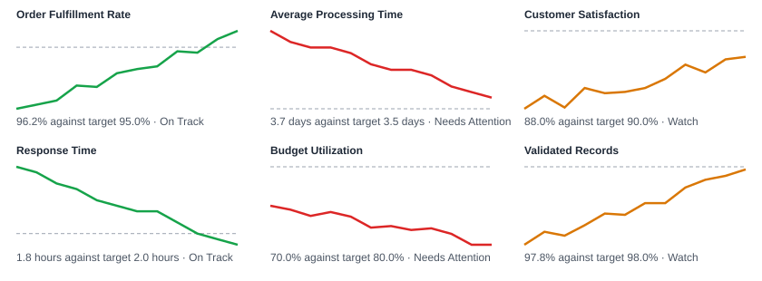

# BI Report Automation

Turns a table of monthly KPI values into a management report: status against target, month-on-month change, a twelve-month trend and written commentary, generated in one command.

All data is synthetic and produced by a script in this repository.

## Sample Output



The full generated report is in [reports/sample_executive_report.md](reports/sample_executive_report.md).

## What It Does

1. Generates twelve months of history for six KPIs across four business areas (fixed random seed, 72 rows).
2. Compares the latest month with its target and with the previous month.
3. Classifies each KPI as On Track, Watch (within 5% of target) or Needs Attention, handling KPIs where lower is better.
4. Draws a trend chart per KPI with the target line, and an inline trend in the status table.
5. Writes commentary and next actions in Markdown, so the report reads directly on GitHub.

## Repository Structure

```text
.
├── data/
│   └── sample_kpis.csv
├── docs/
│   ├── nda-safety.md
│   └── project-notes.md
├── reports/
│   ├── kpi_trends.svg
│   └── sample_executive_report.md
├── src/
│   ├── generate_report.py
│   └── generate_synthetic_kpis.py
├── tests/
│   └── test_generate_report.py
├── .gitignore
├── LICENSE
└── README.md
```

## Quick Start

Python 3.10 or later, standard library only.

Generate the synthetic KPI dataset:

```bash
python src/generate_synthetic_kpis.py
```

Generate the report and chart:

```bash
python src/generate_report.py
```

Run the tests:

```bash
python -m unittest discover -s tests
```

## Data Format

One row per KPI per month:

| Column | Meaning |
| --- | --- |
| `month` | Reporting month, `YYYY-MM` |
| `business_area` | Owning area |
| `kpi_name` | KPI name |
| `value` | Value for the month |
| `target_value` | Target |
| `unit` | `%`, `days`, `hours` |
| `higher_is_better` | `true` or `false` |

To use the report on other data, replace `data/sample_kpis.csv` with a file in the same shape.

## Where This Pattern Fits

- Monthly business reviews
- Narrative summaries to accompany a dashboard
- KPI monitoring and data-quality status reports

## Data Policy

Only synthetic data belongs in this repository. See [docs/nda-safety.md](docs/nda-safety.md) for the checklist.

## Author

Maha Fouad

Data Scientist | BI Developer | AI Automation Engineer
